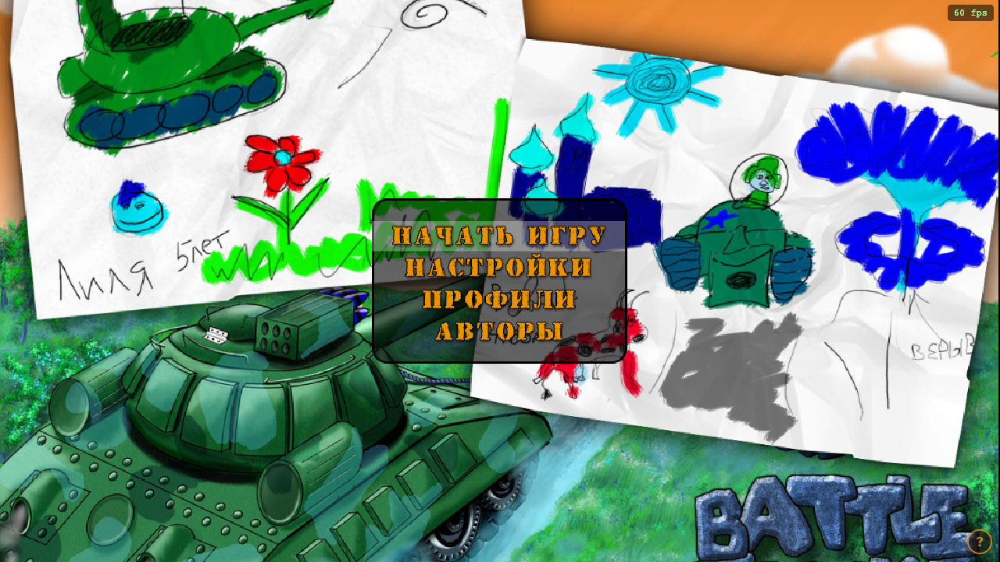
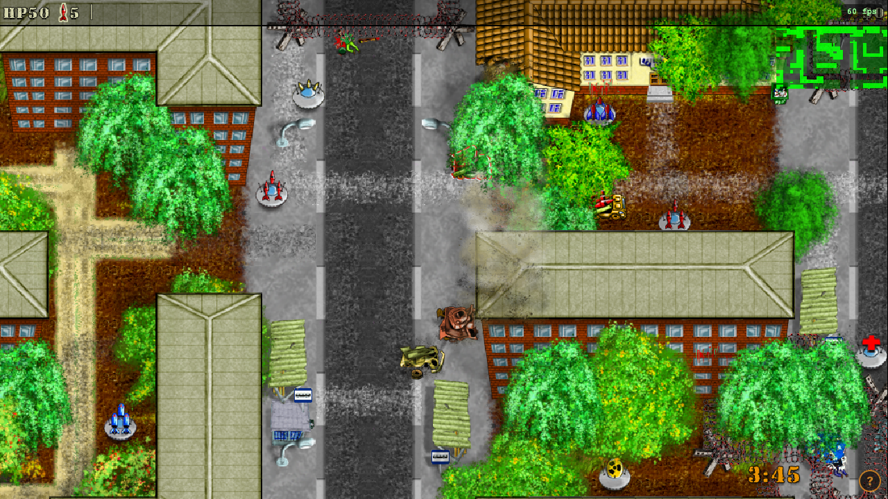
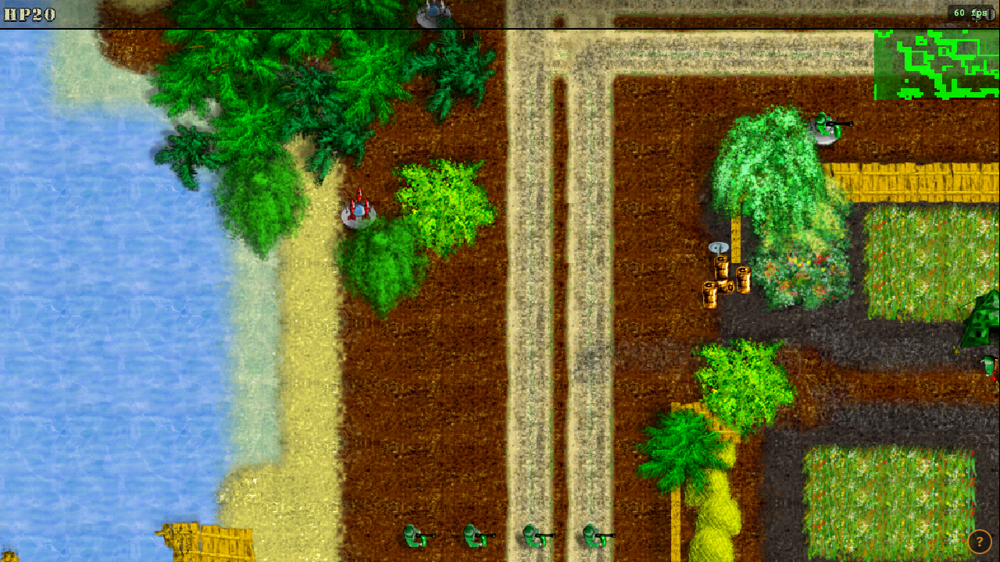

<div align="center">

# Battle Tanks Remastered

**Игра детства. Снова на современных компьютерах.**

[](https://github.com/OneDeadMachine-Dev/btanks-remastered/actions/workflows/ci.yml)

[English](README.en.md) · [Сборка и запуск](docs/BUILDING.md) · [Авторы](CREDITS.md) · [Как помочь](CONTRIBUTING.md)



*Оригинальная графика Battle Tanks — Netive Media Group. Кадр из текущей Web-сборки.*

</div>

## Почему я вернулся к этой игре

Battle Tanks — игра моего детства. Мы с сестрой любили в неё играть, и спустя много лет я просто не смог пройти мимо знакомых танков.

Захотелось снова запустить её на современном компьютере. Сохранить ту самую рисованную графику, музыку и ощущение игры — и дать возможность вернуться в неё другим. Так появился **Battle Tanks Remastered**.

Это личный проект по сохранению и развитию Battle Tanks. В его основе — работа оригинальной команды **Netive Media Group**; современным портом занимается **[OneDeadMachine](https://github.com/OneDeadMachine-Dev)**.

## Что это за игра

Быстрая двухмерная аркада с видом сверху: танки, «Шилки», ракетные установки, пехота, боты и разрушаемое окружение. Можно сражаться друг с другом, проходить совместные миссии, подбирать оружие и покидать уничтоженную технику.

В комплекте **13 карт**, режимы deathmatch, team deathmatch, cooperative и capture the flag. Сохранены исходные спрайты, карты, музыка и звуки.

<table>
<tr>
<td width="50%"><br><strong>Curfew</strong> — городские бои</td>
<td width="50%"><br><strong>Baykonur</strong> — совместная миссия</td>
</tr>
</table>

## Что меняет ремастер

- **Современная macOS:** SDL3, GPU-отрисовка, широкий экран и самодостаточное приложение `.app`.
- **Игра в браузере:** WebAssembly и WebGL2, локальные режимы, настройки и профиль в IndexedDB.
- **Обновлённая основа:** атласы текстур, фиксированный шаг симуляции, исправления столкновений, ввода, сети и сохранения.
- **Сохранённый характер:** исходный контент и игровой движок продолжают жить в проекте.

| Платформа | Состояние |
|---|---|
| macOS / Apple Silicon | Сборка и игровые сценарии проверены локально |
| Современный браузер / WebGL2 | Сборка и все карты проверены; сеть отключена |
| Windows и Linux | Исторические исходники сохранены; сборки этого ремастера пока не проверены |
| Телефон / планшет | Сенсорное управление ещё предстоит сделать |

Ремастер находится в разработке. Сетевой сценарий проверен на одном компьютере с двумя клиентами; реальные LAN/NAT, физический геймпад и звук на реальном устройстве требуют отдельной проверки. [Подробнее о проверках](docs/TESTING.md).

## Запустить из исходников

### macOS / Apple Silicon

Нужны Xcode Command Line Tools и Homebrew. В корне клонированного репозитория:

```sh
brew install sdl3 libvorbis expat scons pkgconf
./build-mac.sh
./run-mac.sh
```

Чтобы собрать приложение со всеми библиотеками и данными внутри:

```sh
./make-app.sh
```

Результат: `dist/Battle Tanks.app`. Подпись ad-hoc предназначена для локальной сборки; для распространения подписанного приложения нужны Developer ID и нотаризация.

### Браузер

```sh
brew install emscripten cmake ninja
./make-web.sh serve
```

Открой [localhost:8765](http://localhost:8765/index.html?fps). При первой сборке загружаются зависимости Emscripten и Expat. Это локальный запуск; опубликованной демоверсии пока нет.

[Подробные инструкции, режимы сборки и настройки](docs/BUILDING.md).

## Управление

| Клавиша | Действие |
|---|---|
| Стрелки | Движение |
| Пробел | Основное оружие |
| Shift | Дополнительное оружие |
| E | Войти в технику / выйти из неё |
| Tab | Таблица очков |
| M | Карта |
| Esc | Меню |

В Web-версии кнопка **?** открывает подсказку. Управление можно изменить в настройках.

## Спасибо создателям оригинала

| Участник | Работа над оригиналом |
|---|---|
| Vladimir **“Whoozle” Menshakov** | Программирование |
| Alexander **“Methos” Wagner** | Графика |
| Vladimir **“VZ” Zhuravlev** | Дизайн уровней |
| Vladimir **“Gold” Goldobin** | Инструменты |
| Vladimir **“Petrovich” Volkov** | Музыка |
| Leonid **“Dark Matter” Volkov** | Звуковые эффекты |
| **Netive Media Group, 2006–2009** | Геймдизайн |

Спасибо за игру, к которой хочется возвращаться спустя столько лет.

[Полные сведения об авторах и происхождении](CREDITS.md) · [Оригинальный проект на GitHub](https://github.com/whoozle/btanks) · [SourceForge](https://sourceforge.net/projects/btanks/)

Основа этого порта — **SVN r8098, 2010 год**. Это дата исходного снимка, а не утверждение о прекращении поддержки: в [новостях проекта](https://sourceforge.net/p/btanks/news/) за 2013 год сообщается о переносе разработки на GitHub.

## Что дальше

Ближайшие направления: сенсорное управление, перенос редактора карт на SDL3, дальнейшая проверка native-мультиплеера и исследование сети для Web-версии. Это планы, а не уже доступные возможности.

Баг-репорты, проверки на другом оборудовании и небольшие понятные исправления помогут проекту. [Как присоединиться](CONTRIBUTING.md).

## Для разработчиков

[Устройство движка](docs/PROJECT_GUIDE.md) · [Проверки](docs/TESTING.md) · [Изменения](CHANGELOG.md) · [Подготовка публикации](docs/PUBLISHING.md)

Основной код находится в `btanks-code/trunk`. В `btanks-code/branches` сохранены исторические материалы, не участвующие в текущей сборке.

## Лицензии

Оригинальные copyright и титры сохранены. Основной текст — [GNU GPL v2](LICENSE); заголовки игровых исходников предусматривают версию 2 или более позднюю. Историческое [LICENSE.EXCEPTION](LICENSE.EXCEPTION) сохранено без изменений. Встроенные библиотеки имеют собственные условия — см. [THIRD_PARTY_NOTICES.md](THIRD_PARTY_NOTICES.md).
