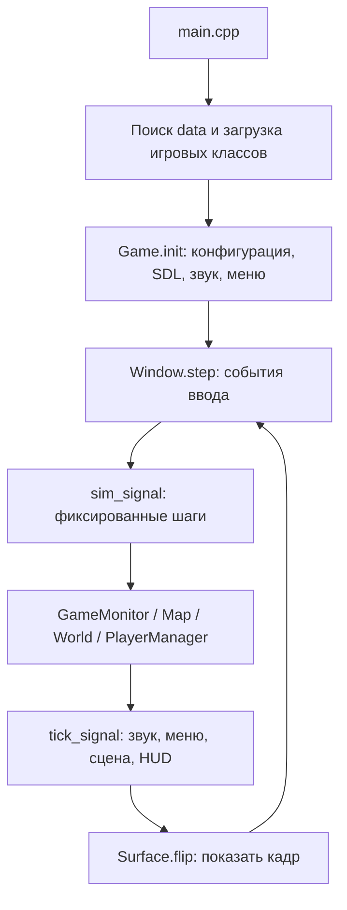

# Battle Tanks Remastered: рабочая карта проекта

Архитектура изучена **20 октября 2026 года**; сводка проверок обновлена **21 октября 2026 года**. Базовая ревизия ремастера: `ffc98c5`, последующие исправления находятся в текущем дереве исходников.
Документ описывает проверенное состояние этого checkout. Это ориентир для последующей разработки, а не утверждение о полной готовности игры к выпуску.

## Что это за проект

Battle Tanks — двухмерная аркада с видом сверху на собственном C++-движке. Основной игровой цикл: выбрать карту и технику, перемещаться по многослойному окружению, уничтожать противников, подбирать оружие и лечение, выполнять условия миссии либо соревноваться с другими игроками. Есть выход из машины и посадка в технику, пехота, боты, разрушаемое окружение, мины, ракеты, дополнительные эффекты оружия, радар и возрождение.

Характер оригинала — рисованная, немного гротескная военная аркада: объёмные спрайты, фактурные поверхности, декоративные растровые шрифты, музыка и позиционный звук. Технический ремастер сохраняет исходные ресурсы и игровые классы, меняя платформенный слой, рендер, игровой цикл и сборку. История изменений `data/` содержит только исходный импорт; нового набора графики в истории ремастера не обнаружено.

В этой папке находятся два исторических слоя:

1. **Оригинал:** SVN Battle Tanks r8098, отдельная библиотека Clunk r125, исходники, карты и старые ветки.
2. **Локальный ремастер:** 21 Git-коммит 5–6 октября 2026 года под именем `OneDeadMachine`, начиная с уже работающего порта через SDL 1.2 compatibility layer и далее с переходом на SDL3 и WebAssembly.

Авторы, происхождение и ссылки на оригинал разобраны в [HISTORY_AND_AUTHORS.md](HISTORY_AND_AUTHORS.md).

## Что доступно в комплекте

В `data/maps` находятся **13 TMX-карт**, все с тайлом 64×64. Размеры ниже — в тайлах, без пересчёта в пиксели.

| Карта | Размер | Слоёв | Стартовых точек | Особенности по данным |
|---|---:|---:|---:|---|
| `aqua_world` | 30×30 | 30 | 8 | Водная карта |
| `arena` | 40×40 | 22 | 4 | Cooperative, Lua: волны противников и награды |
| `baykonur` | 50×50 | 34 | 4 | Cooperative, ограничение стартового персонажа |
| `curfew` | 40×30 | 32 | 5 | Город |
| `dune` | 22×25 | 16 | 4 | Cooperative, настройка противников и дальности обнаружения |
| `four_rooms` | 30×25 | 23 | 4 | Зацикленные границы (`map.torus`) |
| `gaddino` | 30×25 | 26 | 4 | Зацикленные границы |
| `hell_swamp` | 40×30 | 22 | 4 | Болото, поезд, ограничения вооружения |
| `lenin_square` | 29×26 | 27 | 4 | Зацикленные границы, вертолёт |
| `paintball` | 20×20 | 19 | 8 | Повышенная непроходимость по умолчанию |
| `platform` | 20×80 | 36 | 4 | Cooperative, Lua: изменение карты по событию |
| `university` | 18×18 | 23 | 4 | Lua: обучение и подсказки |
| `wastes` | 35×25 | 34 | 6 | Арена |

Число стартовых точек не равно проверенному максимальному числу игроков. Типы игры из `engine/src/game_type.h`: deathmatch, cooperative, racing, capture the flag и team deathmatch. В проверенном браузерном меню видны deathmatch, team deathmatch, cooperative и capture the flag. Наличие `Racing` в enum само по себе не подтверждает законченный режим гонок.

**Кампании:** классы кампаний, магазина, медалей и прогресса существуют, но `campaign.xml` в отслеживаемых файлах и базовом `data/` отсутствует. `CampaignMenu` ищет этот файл через `Finder`; без него `MainMenu` не добавляет пункт кампаний. В браузерном запуске пункта кампаний действительно нет. Поэтому базовый комплект следует описывать как отдельные карты и миссии. Поддержка кампаний в движке и наличие готовой кампании — разные факты.

## Структура и границы модулей

Все пути в таблице, кроме явно указанных, отсчитываются от `btanks-code/trunk/`.

| Путь | Ответственность | Когда сюда идти |
|---|---|---|
| `engine/src/main.cpp` | Точка входа, поиск каталога данных, плагины, запуск | Ошибка старта, перенос приложения |
| `engine/src/game.cpp` | Инициализация, режимы запуска, связь систем, симуляция и отрисовка | Изменение общего игрового потока |
| `engine/src/window.cpp` | SDL-события, окно, шаг симуляции, кадры, автосохранение | Ввод, FPS, vsync, зависимость от частоты экрана |
| `engine/src/world.*` | Объекты мира, движение, столкновения, удаление, сетевые обновления | Физика, взаимодействия, синхронизация |
| `engine/src/base_object.*`, `object.*` | Базовое состояние, эффекты, анимации, группы, жизнь объекта | Общие правила игровых сущностей |
| `engine/src/resource_manager.*`, `registrar.*` | Фабрика классов, XML-ресурсы, загрузка изображений и масок | Новый тип или внешний вид объекта |
| `engine/src/game_monitor.*` | Загрузка миссии, предметы, зоны, победа/поражение, Lua | Сценарии и правила уровня |
| `engine/src/player_manager.*`, `player_slot.*`, `player_state.*` | Игроки, управление, камеры, respawn, сетевые сообщения | Локальные игроки и мультиплеер |
| `engine/src/config.*`, `rt_config.*` | Сохраняемые параметры и состояние текущей игры | Настройки, профили, параметры миссии |
| `engine/src/campaign.*` | Прогресс кампаний, товары, результаты, медали | Новая кампания |
| `engine/controls/` | Клавиатура, мышь, джойстик | Раскладки и методы управления |
| `engine/ai/` | Общие алгоритмы ботов, цели, маршруты, поведение | Решения ИИ |
| `objects/` | Конкретная техника, пехота, пули, ракеты, эффекты, предметы | Механика конкретного оружия или существа |
| `engine/tmx/` | Карты, тайлсеты, слои, проходимость, разрушение | Геометрия уровней и её свойства |
| `engine/luaxx/` | Lua 5.1, мост в игровой API | Новая функция для сценариев |
| `engine/menu/`, `engine/src/hud.*` | Собственный растровый UI, меню и HUD | Экран выбора карты, настройки, радар |
| `engine/net/` | TCP/UDP, сообщения, монитор соединений, поиск серверов | Транспорт сети |
| `engine/sound/`, `clunk/` | Ogg/Vorbis, микшер, позиционный звук | Музыка и звуковые эффекты |
| `sdlx/` | Обёртки SDL3, поверхности, текстуры, окна, ввод, потоки | Платформенный и графический слой |
| `mrt/`, `math/` | Файлы, ZIP, XML, сериализация, сокеты, математика | Инфраструктура движка |
| `third_party/lua/`, `third_party/stb/` | Встроенные Lua 5.1.5 и stb_image | Внешние зависимости исходниками |
| `data/` | Общий набор контента для обеих сборок | Карты, спрайты, звук, тексты |
| `editor/` | Старый собственный редактор | Требует отдельного переноса на SDL3 |
| Корневые `web/`, `packaging/macos/` | Веб-оболочка и упаковка macOS | Браузер, доставка приложения |
| `btanks-code/branches/` | Старые ветки `tiles-32`, `tunes-128` | Историческая справка; текущие сборки их не используют |

Движок широко использует глобальные singleton-системы (`Game`, `Window`, `Map`, `World`, `Config`, `ResourceManager`, `PlayerManager`, `GameMonitor`, `Mixer`) и сигналы/слоты. Границы каталогов не означают полной независимости: `game.cpp`, `world.cpp`, `player_manager.cpp` и `game_monitor.cpp` связывают несколько систем сразу.

## Как проходит запуск и кадр



- Нативная версия загружает `libbt_objects.dylib`; статические регистраторы объектов наполняют фабрику.
- В веб-версии классы слинкованы в общий WASM. `main.cpp` выставляет `disable_network=true` и `local_game=true`.
- `Game::resource_init()` загружает найденные `resources.xml` и строит меню. `GameMonitor::loadMap()` связывает TMX, объекты, overrides параметров и одноимённый Lua-файл.
- На desktop `Window::run()` вызывает `step()` в цикле. В браузере его вызывает `emscripten_set_main_loop_arg`.
- Частота симуляции по умолчанию **120 шагов/с**. В оконном цикле параметр `engine.simulation-rate` ограничен диапазоном 30–480; за кадр выполняются максимум восемь шагов, лишний накопленный долг сбрасывается. Долгая пауза ограничивается 0,1 с. Поэтому фиксированный шаг не является обещанием сохранения реального времени при любой перегрузке.
- `onSimTick()` обновляет правила миссии, карту, мир, игроков и сеть. `onTick()` обслуживает звук, меню, рисование и HUD. Отдельный dedicated-server цикл находится в `Game::run()`; это другой путь исполнения.

## Как связаны код, ресурсы и сценарии

### Тип объекта и его внешний вид

Имена **типа объекта**, **анимации** и **общего classname** не взаимозаменяемы.

Пример танка:

1. В `objects/ai_tank.cpp` зарегистрирован `"tank"` как `AITank("fighting-vehicle")`.
2. Механика оружия и движения находится в `objects/tank.cpp`; AI-обёртка добавляет поведение `ai::Buratino`.
3. В `data/resources.xml` анимация `red-tank` связывает `tank02.png` с моделью `tank-animation`.
4. Фабрика создаёт объект по сочетанию вроде `createObject("tank", "red-tank")`.

`REGISTER_OBJECT` объявлен в `engine/src/registrar.h`. XML-алиасы позволяют переиспользовать C++-класс с вариантами: например, `tank-bullet` ссылается на `bullet(auto-aim)`. Поведение нового оружия обычно требует C++; новый облик или комбинация уже имеющихся вариантов часто обходится изменениями данных.

### Контент

- `data/resources.xml`: модели анимаций, позы, изображения, звуки на кадрах, алиасы.
- `data/preload.xml`: предзагрузка ресурсов.
- `data/tiles/`: спрайты и сопутствующие `.map`-файлы масок столкновений.
- `data/tilesets/`: графика и XML-описания тайлсетов.
- `data/maps/<name>.tmx`: слои, свойства, стартовые точки, объекты и зоны.
- `data/maps/<name>.lua`: необязательная логика миссии. В комплекте это `arena`, `platform`, `university`.
- `data/maps/*.jpg`: превью и тактические изображения карт.
- `data/strings.xml`: локализация, сообщения, подсказки.
- `data/font/`: растровые шрифты; `data/sounds/`, `data/tunes/`, `data/playlist`: звук и музыка.

`Finder` ищет обычные каталоги и ZIP-пакеты `resources.dat`, учитывает `engine.mods` и суффиксы ресурсов, включая новогодний вариант. Это существующая точка расширения контентом. В браузер по умолчанию встраивается только `trunk/data` через `--preload-file`; произвольный внешний мод автоматически туда не попадёт.

### Формат карт

Старый [README-editor.txt](../btanks-code/trunk/README-editor.txt) остаётся полезным описанием расширений TMX. Реальное поведение нужно сверять с `engine/tmx/` и `GameMonitor::loadMap()`.

| Свойство TMX | Назначение |
|---|---|
| `object:OBJECT:ANIMATION:ID` | Объект, внешний вид и уникальное имя; значение — позиция |
| `spawn:ID` | Стартовая точка игрока |
| `config:KEY` → `TYPE:VALUE` | Переопределение параметра карты (`bool`, `int`, `float`, `string`) |
| `zone:TYPE:NAME:SUBNAME:ID` | Зоны подсказок, таймеров, checkpoints, скриптов и других событий |
| `waypoint:OBJECT:ID`, `edge:ID1:ID2` | Маршруты объектов |
| `ambient-sound` | Фоновый звук |

Есть глубина `z` и разделение на `z-box` для отдельных пространств и высот; значения нельзя заменять обычным порядком рисования. У некоторых карт границы замкнуты в тор (`map.torus`). Проходимость и разрушение обрабатывает собственная система карты/мира с масками столкновений, а не сторонний физический движок.

Совместимость с текущими версиями Tiled не проверена. Наличие расширения `.tmx` не гарантирует безопасное пересохранение старого формата современным редактором.

### Lua

Ключевые callback: `on_load`, `on_tick`, `on_spawn`, `on_tooltip`, `on_timer`. Точный список функций игрового API — в `LuaHooks::load()` в `engine/luaxx/lua_hooks.cpp`.

Примеры API: `spawn`, `spawn_random`, `kill_object`, `object_exists`, `damage_map`, `set_config_override`, `display_message`, `game_over`, `set_timer`, `load_map`, управление AI и waypoint. В `platform.lua` есть небольшой пример отложенного разрушения участка карты; `arena.lua` показывает генерацию волн.

В сетевом режиме ряд сценарных обработчиков запускается только на стороне, которая не является клиентом. При добавлении новой функции нужно проверить этот контекст, сериализацию изменённого состояния и обе сборки.

## Рендер, ввод и сеть

**Рендер:** `sdlx/surface.cpp` сохраняет старый интерфейс `Surface`/`blit`, но вывод на экран идёт через `SDL_RenderTexture`. CPU-поверхности остаются нужны для загрузки изображений, масок столкновений и части преобразований. GPU-кеш содержит отдельные текстуры и общие атласы небольших поверхностей. После прямой записи пикселей важна инвалидация кеша. Виртуальный размер сцены и физический размер окна различаются; координаты мыши преобразуются через `SDL_ConvertEventToRenderCoordinates`.

SDL выбирает renderer во время запуска; при неудаче есть fallback на `software`. Metal — целевой путь macOS из README, а не гарантия только по факту использования SDL3. В браузерной проверке использован web-путь; native Metal в этом изучении отдельно не запускался.

**Управление:** `engine/controls/default_keys.cpp` содержит три раскладки, `keyplayer.cpp` читает настройки профиля и переводит старые коды SDL 1.2. Одиночная раскладка Mac/web: стрелки, Пробел — огонь, левый Shift — дополнительное оружие, E — посадка/выход, 1 — подсказки. Общие команды: Tab — статистика, M — карта, Esc — меню. Настройки профиля могут перекрывать значения по умолчанию. Первая и вторая раскладки для игры вдвоём отличаются от одиночной; подсказка в HTML описывает именно одиночную.

**Нативная сеть:** собственные бинарные сообщения, TCP и UDP, фоновый `Monitor`, сжатие, полный мир при входе и последующие обновления, синхронизация состояния игроков и разрушений. В клиентском коде есть локальный пересчёт движения и интерполяция. Поэтому нельзя считать сетевую модель полностью изученной по одному серверному циклу; доверие к клиенту, рассинхронизации и совместимость протокола требуют отдельной проверки. Игровой порт по умолчанию — 27255. Старый master server `btanks.svalko.org` больше не используется по умолчанию; список серверов и прямая LAN-сессия — разные пути.

**Веб-сеть:** отключена в точке входа. Пункт локального старта использует общую игровую инфраструктуру без создания сетевого сервера. Перенос в WebSocket потребует адаптации транспорта и проверки протокола; добавление одной кнопки или прокси само по себе не завершает мультиплеер.

## Сборка, запуск и данные игрока

Из корня репозитория:

```sh
# macOS; зависимости устанавливать при необходимости
brew install sdl3 libvorbis expat scons pkgconf
./build-mac.sh
./run-mac.sh

# macOS bundle; пересоздаёт dist/"Battle Tanks.app"
./make-app.sh

# Web; зависимости устанавливать при необходимости
brew install emscripten cmake ninja
./make-web.sh
./make-web.sh serve
```

Сборка macOS: SCons, C++17, встроенный Lua, отдельные dylib (`mrt`, `sdlx`, `clunk`, `btanks_engine`, `bt_objects`). Скрипт использует Homebrew prefix текущей машины. `main.cpp` находит `data` около бинарника либо в `Contents/Resources`; dylib используют `@rpath`. `make-app.sh` копирует зависимости, ресурсы и подписывает приложение ad-hoc. Упаковка и подпись проверены локально; запуск на другом Mac пока не проверялся.

Сборка Web: `web/CMakeLists.txt`, CMake/Ninja/Emscripten, C++17, WASM exceptions, статическое связывание движка и объектов. SDL3/Vorbis/Ogg/zlib берутся через Emscripten ports, expat 2.9.0 — через FetchContent, Lua и stb — из дерева. При конфигурации и отсутствии кешей нужен доступ к зависимостям. Полностью чистая offline-сборка не проверена.

Выход Web: `build-web/out/index.html`, `index.js`, `index.wasm`, `index.data`. Начальная память задана 256 MiB с разрешённым ростом. Контент — примерно 30 MB. Параметры страницы: `?fps`, `?args=--no-sound,--lang=ru`. Счётчик `?fps` измеряет `requestAnimationFrame` страницы; его нельзя выдавать за измерение производительности всей симуляции.

Сохраняемые настройки и профили находятся в **`~/.btanks/bt.xml`** на macOS. Лог по умолчанию — `~/.btanks/log`. Файл конфигурации также хранит данные прогресса кампаний, если соответствующий контент установлен. Это внешние пользовательские данные, а не файлы checkout. Обычный запуск может мигрировать параметры и сохранять их примерно каждые 10 секунд.

В браузере тот же конфиг находится в виртуальном `/home/web_user/.btanks`, смонтированном в IDBFS/IndexedDB; загрузка выполняется до старта, сохранение — после автосохранения и при скрытии страницы. Хранилище привязано к origin: `localhost` и `127.0.0.1`, а также разные порты, дают разные области сохранения. Живое сохранение произвольной игровой сцены этими механизмами не подтверждено: речь о конфиге, профиле и предусмотренном прогрессе.

Исходные `README-en.txt`, `README-linux.txt` и другие файлы описывают старую сборку. Флаги `--no-gl` и `--force-gl` из старых инструкций не являются актуальными переключателями нынешнего SDL3-рендера. `--help` и обработчики аргументов в `game.cpp`/`window.cpp` — более надёжная отправная точка. Проверенные исходником аргументы включают `--map=`, `--lang=`, `--no-sound`, `--server`, `--bind=`, `--port=` и `--connect=`. Серверные проверки и их ограничения описаны в [TESTING.md](TESTING.md).

## Как выбирать место изменения

| Задача | Начальные файлы | Что дополнительно проверить |
|---|---|---|
| Баланс танка | `objects/tank.cpp`, `Config`-ключи `objects.tank.*` | Overrides TMX, AI-обёртку, сохранённый конфиг |
| Новое оружие | `objects/`, `registrar.h`, `data/resources.xml` | Спрайты, маски, звук, сериализацию и web-сборку |
| Новая миссия | Копия TMX + одноимённый Lua | Spawn/zone, локализацию, preview, условия победы |
| Новая кампания | `campaign.*`, `campaign_menu.*`, пакет с `campaign.xml` | Схему XML по парсеру, профиль, прогресс, магазин |
| Облик объекта | `resources.xml`, `data/tiles/` | Размер кадров, animation-model, маску столкновений |
| Меню и HUD | `engine/menu/`, `hud.cpp`, `data/font/`, ресурсы UI | Логические размеры, широкие экраны, split-screen |
| Клавиши | `default_keys.cpp`, `keyplayer.cpp`, `redefine_keys.cpp` | Миграцию SDL-кодов, профиль, HTML-подсказку |
| Мобильное управление | `web/shell.html`, SDL input, `engine/controls/` | Multi-touch, масштаб, два действия одновременно |
| Мультиплеер в браузере | `engine/net/`, `player_manager.cpp`, web build | Потоки, транспорт, сериализацию, задержки, два клиента |
| Редактор | `editor/`, его SConscript, SDLX | SDL 1.2 API и совместимость TMX; `bted` не входит в текущую сборку |

## Что подтверждено и что ещё открыто

Команды сборки: [BUILDING.md](BUILDING.md). Актуальная сводка проверок: [TESTING.md](TESTING.md). Исправления современного порта: [CHANGELOG.md](../CHANGELOG.md).

- Подтверждены структура исходников и контента, титры оригинальной команды, происхождение SVN-снимка и последующий перенос оригинала в GitHub.
- Пересобраны macOS-приложение и Web; все 13 карт проверены в браузере и по 31 секунде симуляции под ASan/UBSan на macOS.
- Компонентные тесты проверяют маски, сохранение, сериализацию, часы, очистку мира и ввод. Исправления масок, сети, respawn, ввода и записи конфигурации отражены в текущем коде.
- Проверены два клиента одного IP, отключение/переподключение и отдельный сетевой запуск под санитайзерами. Реальные NAT/LAN и разные компьютеры остаются непроверенными.
- Harness со стрельбой, событиями смерти и 9 сменами карт завершил 600 секунд симуляции после ремонта очистки мира. Это конкретный тестовый сценарий, а не полная игровая приёмка.
- Физический геймпад, звук на реальном устройстве, полный CTF-матч, мобильный ввод, Windows/Linux и старый редактор требуют дальнейшей работы.

Техническое обновление, изменение игрового дизайна и расширение контента — отдельные направления. Текущая задача ремастера — сохранить характер оригинала и сделать его доступным на современных системах.

## Источники внутри проекта

- [Корневой README](../README.md) и локальный `git log`.
- [Титры](../btanks-code/trunk/engine/src/credits.cpp), [ChangeLog](../btanks-code/trunk/ChangeLog), [лицензия](../btanks-code/trunk/LICENSE), [исключение](../btanks-code/trunk/LICENSE.EXCEPTION).
- [Вход в игру](../btanks-code/trunk/engine/src/main.cpp), [координатор](../btanks-code/trunk/engine/src/game.cpp), [цикл окна](../btanks-code/trunk/engine/src/window.cpp).
- [Мир](../btanks-code/trunk/engine/src/world.cpp), [правила миссии](../btanks-code/trunk/engine/src/game_monitor.cpp), [игроки и сеть](../btanks-code/trunk/engine/src/player_manager.cpp).
- [Ресурсы](../btanks-code/trunk/data/resources.xml), [TMX-парсер](../btanks-code/trunk/engine/tmx/map.cpp), [Lua API](../btanks-code/trunk/engine/luaxx/lua_hooks.cpp), [старое описание карт](../btanks-code/trunk/README-editor.txt).
- [SDL3-рендер](../btanks-code/trunk/sdlx/surface.cpp), [нативная сборка](../btanks-code/trunk/SConstruct), [web-сборка](../web/CMakeLists.txt), [HTML-оболочка](../web/shell.html).
